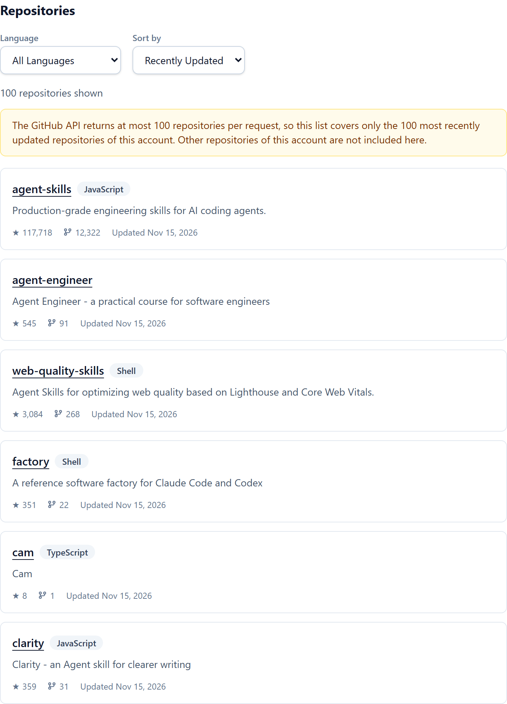
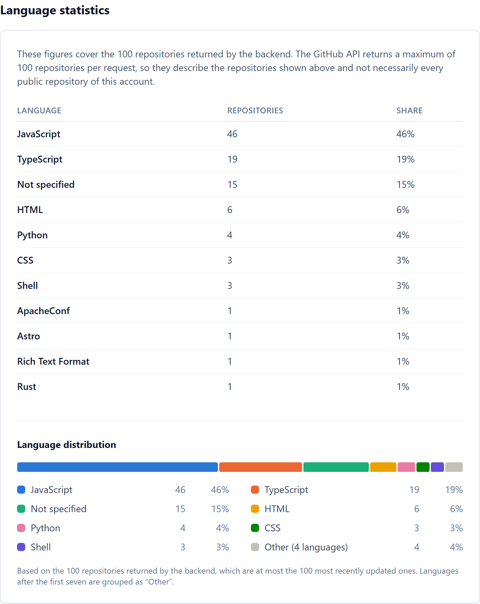

# GitHub Profile Explorer

[](https://github.com/Euricuxs/github-profile-explorer/actions/workflows/ci.yml)
[](https://nodejs.org)

A full-stack web application for searching GitHub developers and organizations and
exploring their public profiles, repositories, and programming language statistics.

The project exists to demonstrate practical full-stack engineering with React, TypeScript,
Node.js and Express: a layered backend, validated request boundaries, one consistent error
contract, server-state management with TanStack Query, and a test suite that covers both
sides of the API.

The **backend is the only component that talks to the GitHub REST API**. The frontend
calls the backend over HTTP, so the API token stays on the server and never reaches the
browser.

## Screenshots

### Developer search

The search term lives in the URL, so a result set can be shared or reloaded. The list shows
the total number of matches GitHub reported and whether each match is a user or an
organization.


### Developer profile

The public profile of an account: avatar, name, bio, company, location, blog, and the
follower, following and public repository counts.


### Repository explorer

Every public repository with its description, language, stars, forks and last update, plus
a filter by language and an order by stars or last update. Filtering, sorting and
pagination all happen in the browser, on the data the backend already returned.



### Language statistics

The count and the share of every language across the returned repositories, as a table and
as a segmented chart drawn as inline SVG.



## Features

- **Search** GitHub users and organizations by username, with a debounced input so the
  strict search rate limit is not exhausted while typing.
- **Profile page** with the avatar, name, login, bio, company, location, blog, follower
  and following counts, and the number of public repositories.
- **Repository list** with the description, language, stars, forks and last update date
  of every repository, and a link to the repository on GitHub.
- **Filtering and sorting** of the repository list by language and by stars or last
  update, with client-side pagination.
- **Language statistics**: the count and the share of every language, as a table and as a
  segmented chart.
- **Shareable URLs**: the search term lives in the query string, so a search and a profile
  can be linked and restored.
- **Accessible by design**: a visible focus indicator on every interactive element, a
  page title and description per route, live-region announcements for the search results,
  and a text alternative for the chart.
- **Clear states** for loading, empty results, missing accounts, rate limits and network
  failures, including a page for unknown addresses.

## Architecture

```
Browser
  │
  │  React SPA  (Vite, :5173)
  │    ├─ TanStack Query   — cache, staleTime, enabled
  │    ├─ api/users.ts     — the three calls to the backend
  │    └─ Axios instance   — baseURL "/api", 12 s timeout
  │
  │  GET /api/users/:username/repos
  │  (one origin: the Vite dev server proxies /api to :3000)
  ▼
Express API  (Node, :3000)
  │
  │    ├─ routes/       — the endpoint definitions
  │    ├─ controllers/  — validate the input, delegate, answer
  │    ├─ schemas/      — Zod validation at the request boundary
  │    └─ services/github.service.ts — the only caller of GitHub
  │
  │  Axios  →  api.github.com
  │  Authorization: Bearer $GITHUB_TOKEN   (optional, server-side only)
  ▼
GitHub REST API
  │
  │  snake_case payload
  ▼
normalised in the service  →  camelCase contract  →  back to the browser
```

The frontend never calls GitHub directly. Every GitHub request goes through the backend,
which is the only place that knows the GitHub API, the rate limits and the token. This
keeps the API key out of the browser, lets the backend normalise GitHub's responses into
the shapes the frontend uses, and gives one place to handle errors and rate limits.

| Concern                | Where it lives                                                          |
| ---------------------- | ----------------------------------------------------------------------- |
| Routes                 | `frontend/src/App.tsx`                                                  |
| Pages                  | `frontend/src/pages/`                                                   |
| Server state           | `frontend/src/hooks/` (TanStack Query)                                 |
| HTTP to the backend    | `frontend/src/api/`                                                     |
| Routes and controllers | `backend/src/routes/`, `backend/src/controllers/`                        |
| Request validation     | `backend/src/schemas/` (Zod)                                            |
| GitHub calls           | `backend/src/services/github.service.ts`                                |
| Error handling         | `backend/src/middleware/errorHandler.ts`, `frontend/src/api/errors.ts`  |

### TanStack Query: server state

All data that lives on the server is owned by TanStack Query, not by `useState`. Each
resource has its own hook in `frontend/src/hooks/`:

- `useUserSearch(term)` — the query key is `['users', 'search', term]`, so every term is
  its own cache entry. `enabled: term.length > 0` means an empty search costs no request
  at all, and `placeholderData: keepPreviousData` keeps the previous list on screen while
  the next term loads.
- `useUserProfile(username)` and `useUserRepositories(username)` — two independent
  queries, so the profile and the repository list load in parallel and each keeps its own
  loading and error state. A failing repository request never hides the profile.

Plain React state is used only for things that belong to the browser: the search text, the
selected language, the sort order and the current page.

### Zod: validation at the boundary

Every request parameter is validated before it reaches a GitHub call, so an invalid
username never spends a rate-limited request:

- `backend/src/schemas/user.schema.ts` — 1–39 characters, letters, digits and single
  hyphens, matching GitHub's own rules.
- `backend/src/schemas/search.schema.ts` — trimmed, non-empty and at most 256 characters.
  The characters themselves are not restricted, so GitHub's own search grammar
  (`location:`, `followers:>100`, …) keeps working.

A validation failure becomes a `400` with a machine-readable code, never a GitHub call.

### The GitHub service

`backend/src/services/github.service.ts` is the only file that knows `api.github.com`
exists. It owns the Axios instance (a 10 second timeout, the `Accept` and
`X-GitHub-Api-Version` headers, and the optional `Authorization: Bearer` token), the
mapping of every GitHub failure onto an `ApiError`, and the normalisation of the raw
responses.

### Error handling

The service throws an `ApiError`, which carries a status and a code. One centralized
middleware turns it into a response, so every failure of the API has the same shape:

```json
{ "error": { "code": "USER_NOT_FOUND", "message": "GitHub user not found." } }
```

GitHub answers a `403` for several different reasons, so a `403` alone does not mean
"rate limited": the service inspects the `x-ratelimit-remaining` header and the response
message before deciding between `RATE_LIMIT_EXCEEDED` and `GITHUB_FORBIDDEN`.

On the frontend, `frontend/src/api/errors.ts` maps each code to a message a person can
act on, and tells a timeout apart from a network failure — they have very different
causes and very different advice.

### Data normalisation

GitHub answers in `snake_case` and sends far more fields than the application uses. The
service maps the responses once — `toUserProfile`, `toRepository`, `toSearchResult` — into
a small camelCase contract. `backend/src/types/github.ts` keeps the raw GitHub types and
the normalised types apart on purpose, so a change in GitHub's response only ever touches
the mapping code.

`frontend/src/types/user.ts` mirrors that contract, so a change on either side shows up as
a TypeScript error instead of a runtime surprise.

## Stack

| Layer     | Technology                                                              |
| --------- | ----------------------------------------------------------------------- |
| Frontend  | React 19, TypeScript 7, Vite 8, Tailwind CSS 4, React Router 8, TanStack Query 5, Axios 1 |
| Backend   | Node.js 26, Express 5, TypeScript 7, Axios 1, Zod 4, cors 2             |
| Testing   | Vitest 5, Supertest 7, React Testing Library 16, jsdom 31              |

## Prerequisites

- Node.js **26.13.1** or newer (see `.node-version`)

## Install

```bash
git clone https://github.com/Euricuxs/github-profile-explorer.git
cd github-profile-explorer
npm ci
```

This is an npm workspaces monorepo, so a single install at the root sets up both
`frontend/` and `backend/`. Use `npm ci` to install exactly the versions in
`package-lock.json`; `npm install` may update the lockfile.

## Run in development

```bash
npm run dev
```

- Frontend: http://localhost:5173
- Backend: http://localhost:3000

The Vite dev server proxies `/api/*` to the backend, so the browser only ever talks to a
single origin and CORS never applies during development.

## Other scripts

```bash
npm run typecheck   # tsc --noEmit in both workspaces
npm run test        # vitest run in both workspaces
npm run lint        # oxlint in both workspaces
npm run build       # production build of both workspaces
```

## Environment variables

Every variable is optional in development — the application runs without any `.env` file
at all. To change them, copy the example files and adjust as needed:

- `backend/.env.example` → `backend/.env` (`PORT`, `CORS_ORIGIN`, `GITHUB_API_BASE_URL`, `GITHUB_TOKEN`)
- `frontend/.env.example` → `frontend/.env` (`VITE_API_BASE_URL`)

`CORS_ORIGIN` is a comma-separated allowlist of browser origins and is only needed in
production, where the frontend and the API are served from different origins. The
`GITHUB_TOKEN` is optional and raises the GitHub rate limit; it must never reach the
frontend.

## Layout

```
frontend/
  index.html
  public/                     favicon.svg, avatar-placeholder.svg
  src/
    main.tsx                  the entry point and the provider stack
    App.tsx                   the routes of the single-page app
    api/                      Axios instance, backend calls, error messages
    components/               the reusable pieces of the interface
    hooks/                    TanStack Query hooks and usePageMeta
    pages/                    HomePage, ProfilePage, NotFoundPage
    types/                    the shapes of the data
    utils/                    pure logic (sorting, filtering, statistics, chart)
    test/                     the tests, with the shared fixtures
backend/
  src/
    server.ts                 the HTTP server
    app.ts                    the Express application
    routes/                   the endpoint definitions
    controllers/              the HTTP handlers
    schemas/                  the Zod validation of the incoming requests
    services/                 the calls to the GitHub API
    middleware/               the shared error handling
    errors/                   the ApiError type
    types/                    the shapes of the GitHub responses
docs/
  screenshots/                the images used in this README
```

## API

| Method | Path                          | Description                                     |
| ------ | ----------------------------- | ----------------------------------------------- |
| GET    | `/api/health`                 | Liveness check.                                  |
| GET    | `/api/users/:username`        | Public profile of a GitHub user.                 |
| GET    | `/api/users/:username/repos`  | Public repositories of a GitHub user.            |
| GET    | `/api/search/users?q=term`    | Search GitHub for users and organizations.       |

`/api/search/users` returns the first page of at most **30 results**:

```json
{
  "totalCount": 42,
  "incompleteResults": false,
  "users": [
    {
      "id": 583231,
      "login": "octocat",
      "avatarUrl": "https://avatars.githubusercontent.com/u/583231?v=4",
      "profileUrl": "https://github.com/octocat",
      "type": "User"
    }
  ]
}
```

`type` is either `User` or `Organization`. `incompleteResults` is `true` when GitHub hit its own search time budget and the result set is partial.

Errors always use the same shape:

```json
{ "error": { "code": "USER_NOT_FOUND", "message": "GitHub user not found." } }
```

| Status | Code                   | Meaning                                            |
| ------ | ---------------------- | -------------------------------------------------- |
| 400    | `INVALID_USERNAME`     | The username does not match GitHub's rules.         |
| 400    | `INVALID_SEARCH_QUERY` | The search query is missing, empty or too long.     |
| 403    | `GITHUB_FORBIDDEN`     | GitHub rejected the request for another reason.     |
| 404    | `USER_NOT_FOUND`       | GitHub has no such user.                            |
| 404    | `NOT_FOUND`            | The API has no such endpoint.                       |
| 429    | `RATE_LIMIT_EXCEEDED`  | GitHub's request rate limit was reached.            |
| 500    | `INTERNAL_SERVER_ERROR`| Unexpected server error.                            |
| 502    | `GITHUB_UNAVAILABLE`   | GitHub could not be reached or returned a 5xx.      |
| 502    | `GITHUB_ERROR`         | GitHub returned an unexpected response.             |
| 504    | `GITHUB_TIMEOUT`       | GitHub did not respond within 10 seconds.           |

An unknown `/api/*` path answers with the same error shape and the status 404, so a client
never has to parse an HTML error page:

```json
{ "error": { "code": "NOT_FOUND", "message": "The requested endpoint does not exist." } }
```

## Testing

```bash
npm run test
```

The suite runs in both workspaces with Vitest.

**Backend** (`backend/src/**/*.test.ts`) — Supertest drives the real Express application
without opening a socket, so the routes, the validation and the error middleware are
exercised together. The GitHub service is tested separately with a mocked Axios.

**Frontend** (`frontend/src/test/`) — React Testing Library renders the real components in
jsdom. The queries are written against roles and labels rather than CSS classes, so the
tests double as accessibility checks. There are unit tests for the pure logic in
`utils/repositories.ts` and `utils/languageChart.ts`, tests for the Axios error mapping,
and an end-to-end flow test that searches, opens a profile, filters the repositories and
reads the statistics.

## Continuous integration

Every push and pull request runs the same checks as the local scripts: install with
`npm ci`, typecheck, test, lint, build and `npm audit`. The workflow lives in
[`.github/workflows/ci.yml`](.github/workflows/ci.yml).

## Where to start reading the code

If you want to understand the project rather than just run it, this order keeps every step
dependent only on the previous ones.

1. `frontend/src/main.tsx` — the entry point and the provider stack: `QueryClientProvider`,
   `BrowserRouter`, `App`.
2. `frontend/src/App.tsx` — the three routes and the catch-all.
3. `frontend/src/pages/HomePage.tsx` — how the URL, a query hook and the four UI states
   (initial, loading, empty, error) fit together.
4. `frontend/src/api/http.ts` and `frontend/src/api/users.ts` — the Axios instance and the
   three calls to the backend.
5. `frontend/src/hooks/useUserSearch.ts` — the clearest example of TanStack Query in the
   codebase: the query key, `enabled`, `keepPreviousData` and `staleTime`.
6. `frontend/src/pages/ProfilePage.tsx` — two independent queries and data derived from
   one of them.
7. `frontend/src/components/RepositoryExplorer.tsx` and `frontend/src/utils/repositories.ts`
   — state, then filter, then sort, then page; and the pure functions underneath that do
   the work and are easy to unit test.
8. `backend/src/server.ts` and `backend/src/app.ts` — the Express application and the
   order of its middleware.
9. `backend/src/routes/` and `backend/src/controllers/` — thin controllers that validate
   and delegate.
10. `backend/src/schemas/` — the Zod schemas at the request boundary.
11. `backend/src/services/github.service.ts` — the heart of the backend: Axios, the error
    mapping and the normalisation.
12. `backend/src/errors/apiError.ts` and `backend/src/middleware/errorHandler.ts` — the
    error contract, and the single place that writes an error response.
13. `frontend/src/api/errors.ts` — the other half of the same contract.
14. `backend/src/routes/users.routes.test.ts` — Supertest against the real application.
15. `frontend/src/test/flow/appFlow.test.tsx` — the whole journey in one test.

## Known limitations

- The repositories endpoint returns a single page of at most **100 repositories** (GitHub's maximum per page), sorted by most recently updated. Accounts with more than 100 public repositories are truncated, and the interface says so instead of claiming that 100 is the total. The list of these repositories is filtered, sorted and paginated in the browser, so the pagination covers the 100 repositories that were returned, not every public repository of the account.
- The search endpoint returns a single page of at most **30 results**. GitHub caps search at 1000 matches in total, and the query is passed to GitHub unchanged so its full search grammar (`location:`, `followers:>100`, ...) works.
- The language statistics describe the repositories that the backend returned (at most 100), not every public repository of the account.
- Without `GITHUB_TOKEN`, GitHub allows only 60 requests per hour per IP address.
- **GitHub's search API has a much stricter rate limit than the rest of the REST API: 10 requests per minute unauthenticated, and 30 requests per minute with a token.** The other endpoints are limited by the hourly 60/5000 requests instead. A frontend search box therefore has to debounce its requests, otherwise a user typing a term will exhaust the search quota in seconds.
- The application is not deployed. The screenshots in this README were taken from the local development server.

## Note

`CLAUDE.md` is a local development guide and is intentionally excluded from Git.
